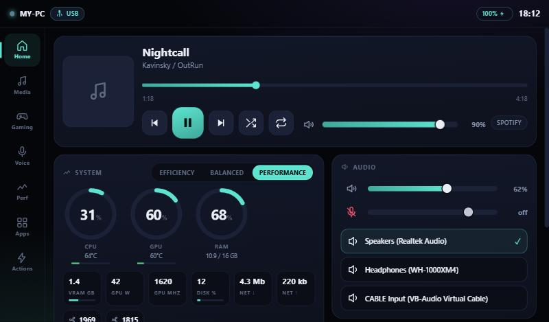

# Companion Deck

Turn an old Android tablet into a control surface for your Windows PC.

Plug the tablet in over USB and it becomes a second screen you can actually touch: now
playing with artwork and a seek bar, a per-application volume mixer, CPU/GPU/RAM gauges,
your installed games and apps with real cover art, and a soundboard that can play into a
voice call.

It was built to make a 2016 tablet with 1 GB of RAM useful again, so the whole thing is
built around not wasting resources. The PC agent collects only what the tablet is
currently showing, at the rate it asks for, and stops entirely when the screen goes off.



## What you need

- **Windows 10 version 2004 (build 19041) or newer.** Earlier builds lack the media-session
  API the now-playing card is built on.
- **An Android 5.0 device or newer**, in landscape, about 600dp wide or more. A 1024x600
  tablet is the sweet spot; a phone held sideways works.
- **A USB cable.** A network connection works as a fallback, including the one Android's
  USB tethering makes over the cable itself.

Nothing is installed system-wide, there is no account, no cloud service, and no IP address
to type anywhere.

## Getting started

```bash
git clone https://github.com/CE5ald/companion-deck.git
```

Then double-click **`Setup.cmd`**.

It checks what the machine is missing, tells you the exact command to fix anything it
cannot do itself, builds both sides, installs the app on a tablet if one is plugged in,
and finishes by printing what your particular PC can and cannot do.

Afterwards, **`Deck.cmd`** is the everyday launcher. Leave it running and plug the tablet
in; it starts the app on the tablet and connects by itself.

### The one thing the tablet needs

There is no way for a PC to open a connection to a stock Android device over USB without
something being switched on first. Every route needs one of these, and this is the honest
comparison:

| Route | What it costs you | What you get |
|---|---|---|
| **USB debugging** (recommended) | Developer options on, once | The cable alone from then on. The app starts itself and connects; nothing to tap, ever again |
| **USB tethering** | A toggle in Settings, no developer options | Works over the cable, but many devices need the toggle flicked each time |
| Wi-Fi | Nothing, if both are on the same network | No cable at all, slightly higher latency |

**You do not have to work any of this out.** Open the app on the tablet and it shows a
three-step guide with a button for each step that opens the right Settings page. The tablet
can read its own developer-options and USB-debugging state, so each step ticks itself green
the moment it is done, and the guide disappears for good once a link has worked once.

After that first run, the promise holds literally: plug the cable in, and the tablet wakes
up and connects by itself.

## What works on which hardware

Every hardware feature is probed at startup, and the tablet is told what is genuinely
available, so a control is only ever drawn when it can actually do something. Run
`CompanionDeck.Host.exe --selftest` to see where your machine lands.

| Feature | Requirement |
|---|---|
| CPU, memory, disk, network, battery | Any PC |
| GPU load and VRAM | Any PC. NVIDIA cards also report temperature, power and clocks through NVML |
| Media control, artwork, seek | Any app that registers with Windows (Spotify, browsers, players) |
| Per-app volume, output and input switching | Any PC |
| Launcher with real cover art | Steam, Epic and Start Menu apps |
| Performance modes | Windows power modes. On Windows 11 and recent Windows 10 these are the "Power mode" settings |
| Screen brightness | A laptop panel, and the elevated agent |
| CPU temperature | The ACPI thermal zone, and the elevated agent |
| Fan speeds | A vendor interface. Not available through any standard Windows API |
| Frames per second | [PresentMon](https://github.com/GameTechDev/PresentMon) installed separately |
| Cast desktop audio into your microphone | [VB-Audio Virtual Cable](https://vb-audio.com/Cable/) installed separately |

### Running elevated

Brightness and CPU temperature are refused by Windows to an ordinary process.
`scripts\Install-Elevated.ps1` registers a logon scheduled task that runs the agent with
full privileges, so those work and you are never prompted again. It is optional, and
everything else works without it.

A scheduled task rather than a service because the agent needs the interactive desktop
session: it synthesises keystrokes and reads the media session of the logged-in user,
neither of which a session-0 service can do.

## How the link works

The tablet listens on an abstract local socket, and the PC reaches it with
`adb forward`. That means the connection travels over the USB cable, nothing is exposed to
your network, and plugging the cable in is the entire connection ceremony.

If no cable is present, the PC broadcasts a small UDP beacon and the tablet dials back over
Wi-Fi. The PC stops beaconing the moment the cable returns.

The tablet never names a file, a path or a URL. It names an **id**, and the PC decides what
that id means by looking it up in its own list. A compromised or spoofed tablet therefore
cannot make the PC launch something that was not already there.

## Layout

```
host/        Windows agent (.NET 8). Telemetry, audio, media, launcher, the link.
tablet/      Android app (Kotlin). A thin shell around a WebView.
  app/src/main/assets/   The UI itself: one HTML file, one CSS file, one JS file.
scripts/     Setup, launch, elevated install.
tools/       A static server for designing the UI in a desktop browser.
```

The tablet UI is a web page rather than Android views because a weak tablet GPU handles
GPU-composited CSS far more happily than a view hierarchy, and because the whole dashboard
can then be designed in a desktop browser without deploying anything.

## Development

```bash
node tools/uiserve.js
```

Serves the UI at `http://localhost:5173` with a mock-data harness, so every card and state
can be worked on without a tablet or even the PC agent running.

Testing the link without a tablet:

```bash
node tools/selftest-link.js
```

Pretends to be a tablet: finds the running agent over the network transport, handshakes,
subscribes to every section and sends every command the real tablet can send, then prints a
pass/fail table. It checks that advertised capabilities are actually backed by readings,
that an empty subscription stops the agent collecting, and that malformed input does not
kill the link.

Useful agent flags:

| Flag | What it does |
|---|---|
| `--selftest` | Prints what this PC can do and exits |
| `--verbose` | Debug-level logging |
| `--probe-adb` | Diagnoses tablet detection |
| `--no-wifi` | USB only; skips the network transport and its beacon |
| `--no-usb` | Network only; lets `tools/selftest-link.js` reach an agent that has a cable attached |

The log is always written to `%LOCALAPPDATA%\CompanionDeck\host.log`, including when the
agent runs from the scheduled task with no console attached.

## Licence

MIT. See [LICENSE](LICENSE).
